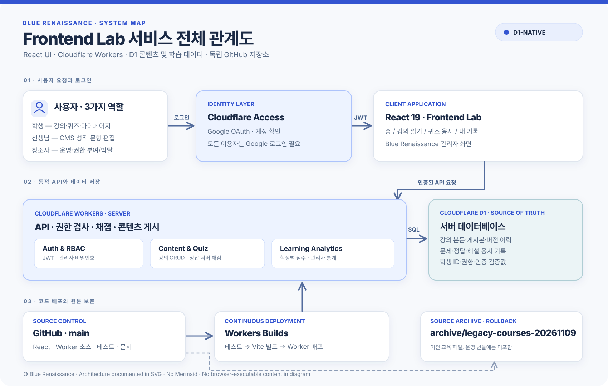

# Frontend Lab × Blue Renaissance

**React 기반 교육 서비스 · Cloudflare Workers + D1**  
운영 사이트: **https://frontend-lab.rhee.life** · CMS: **https://frontend-lab.rhee.life/admin**

> 운영 서비스는 **React UI + Workers 동적 API + D1 데이터베이스**를 중심으로 구성됩니다. 기존 수업별 정적 HTML 및 `.data.js` 문제 파일은 운영 저장소에서 삭제했고, 교육 자료는 D1에 이관했습니다. 원본은 별도 보존 브랜치에 남아 있습니다.

## 원본 Frontend Lab UI를 React로 복원

원래의 내비게이션·히어로·섹션별 카드·퀴즈 패널·AI 단계 학습·강의 페이지 CSS를 **보존 브랜치 기준으로 복원**하고 React 컴포넌트에 적용했습니다. 수업 콘텐츠는 여전히 D1에서 제공하며, 독립 정적 수업 HTML/JavaScript 페이지는 운영 브랜치로 복구하지 않습니다.

[원본 대비 복원 설계 및 검증 범위](modern/docs/VISUAL_PARITY_2026-11-09.md)

## 서비스 전체 구조도



[SVG 파일 원본 보기](docs/blue-renaissance-system-map.svg) · [아키텍처 문서](modern/docs/REACT_D1_REBUILD.md)

## 핵심 구성

| 계층 | 구현 | 책임 |
| --- | --- | --- |
| 프론트엔드 | **React 19 + Vite** | 학습 홈, 강의, 문제풀이, 마이페이지, Blue Renaissance CMS |
| 로그인 | **Cloudflare Access + Google** | 로그인 제공자 및 서명된 사용자 인증 |
| 서버 | **Cloudflare Workers Free** | JWT 재확인, 권한·비밀번호 세션, CRUD, 서버 채점 |
| 데이터 | **Cloudflare D1** | 강의, 문항·정답, 게시본·버전, 학생·점수·권한 |
| 미디어 | **Workers Static Assets** | React 번들·SVG·이미지·글꼴(실행 코드와 미디어만 정적 제공) |
| 배포 | **GitHub main → Workers Builds** | 테스트, Vite 빌드, 배포. GitHub Actions 불필요 |
| 보존 | **`archive/legacy-courses-20261109`** | 이전 정적 HTML/CSS/JS 교육자료 및 수정 이력 검토 |

## 이관 범위

- 교육용 HTML 원본 **44개**를 D1의 강의 레코드로 이관, 기존 원문은 `lab_course_sources`에도 보존.
- 원본 `.data.js` 문제 자료 및 별도 HTML 퀴즈를 **19개 문제 세트 · 243문항**의 D1 문제은행으로 이관.
- AI 기초 6단계 수업은 별도의 `content.data.js` 텍스트 본문을 데이터베이스 본문 블록으로 이관.
- 선생님 CMS에는 **강의 목록·리치텍스트 편집기·초안/게시·이력 복원**, **문제 세트·문항별 편집·보기/정답/힌트·게시** UI를 제공합니다.
- 학생은 **개별 Google 계정 / 고유 학생 ID / 마이페이지 / 응시 기록**을 이용합니다.

> 기존 HTML의 다양한 독립 인터랙티브 실습 화면과 100% 동일한 동작은 별도의 브라우저 회귀 검증이 필요합니다. 기존 원본은 삭제되지 않고 보존 브랜치에 남아 있습니다. **Vite 진입용 `modern/frontend/index.html`은 React 마운트에 필요한 껍데기 파일**이며, 수업 HTML 파일이 아닙니다.

## CMS 권한

| 권한 | 계정 | 담당 |
| --- | --- | --- |
| 창조자 · 0순위 | `sea35652@gmail.com` | 운영 전반 및 관리자 권한 부여·박탈 |
| 선생님 · 1순위 | `spacejh72@gmail.com` | 학습·강의·퀴즈·학생 점수 관리 |
| 추가 관리자 · 2순위 | 창조자가 임명한 계정 | 학습/콘텐츠 관리 |
| 학생 | Google 계정으로 로그인한 이용자 | 학습, 본인 점수 확인 |

관리자 API는 Google Access와 **계정별 별도 비밀번호 세션**을 동시에 검사합니다. 관리자 권한 변경은 창조자 계정만 가능합니다.

## 디렉터리

```text
README.md
docs/
  blue-renaissance-system-map.svg     ← 순수 SVG 시스템 관계도
modern/
  frontend/
    index.html                         ← React 앱 부트스트랩
    src/                               ← React 교육 화면, CMS, CSS
    worker/                            ← API · D1 · Google 인증 및 권한
    migrations/                        ← D1 스키마
    public/                            ← SVG 브랜드·이미지 등 정적 미디어
    tests/                             ← 회귀·권한·데이터 모델 테스트
  docs/                                ← 상세 개발/운영 보고서
```

## 로컬 개발·배포

```bash
cd modern/frontend
npm install
npm test
npm run build
```

프로덕션은 Cloudflare Workers Builds에서 `main`을 자동 배포하며, `npm test && npm run build` 후 `npx wrangler deploy`을 실행합니다. 기존 D1 데이터는 GitHub 커밋과 별도이며 임의 삭제하지 않습니다.

[React+D1 구조 변경 기록](modern/docs/REACT_D1_REBUILD.md) · [권한 정책](modern/docs/CREATOR_RBAC.md) · [보안](modern/docs/SECURITY.md) · [운영](modern/docs/OPERATIONS.md)

### 저작권·교육자료

이 프로젝트는 독립 GitHub 저장소로 운영되며 초기 교육자료의 출처는 [JJinMangGo/frontend-lecture](https://github.com/JJinMangGo/frontend-lecture)입니다. **독립 운영과 원저작권 이전은 별개**입니다. 원본 교사 저장소에 PR을 보내거나 원저작물에 임의 라이선스를 선언하지 않았습니다.

_최종 UI 및 강의 기능은 실제 Google 계정에서의 브라우저 E2E 검증과 교사 검수 후 공식 수업에 활용하세요._
