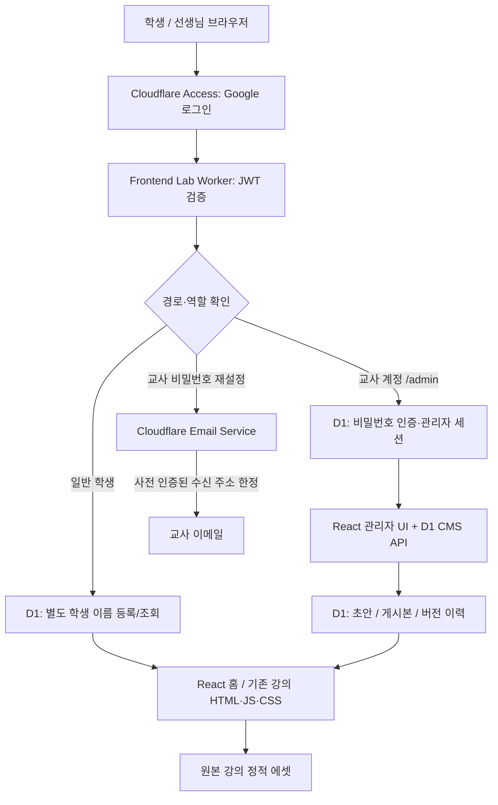

# 시스템 아키텍처와 데이터 흐름

최종 구현: **React 19 + Vite + Cloudflare Workers Free / Access + D1 / 원본 HTML·JS·CSS 정적 자료**

이 문서는 [전체 제작 기록](DEVELOPMENT_HISTORY.md)과 [운영 절차](OPERATIONS.md)를 보완합니다. **실제 사용자의 인증·쿠키·퀴즈 흐름은 자동 테스트만으로 검증 완료되지 않았습니다.**

## 1. 논리 구성

**핵심 경계:** Google Access는 요청자가 누구인지 증명하고, 별도 학생 이름 등록은 강의 열람 조건을 결정합니다. 교사 전용 데이터 수정은 검증된 Google 이메일과 **추가 비밀번호 세션**을 모두 확인합니다. Cloudflare Access의 `Allow Everyone`은 인증 자체를 우회하는 `Bypass`와 다릅니다.

## 2. 디렉터리 및 책임 분리

| 경로 | 책임 |
| --- | --- |
| 최상위 `index.html` / `ai/` / `grid/` / `flex/` / `javascript/` / `quiz/` 등 | 선생님이 만든 기존 콘텐츠와 그 동작 |
| `modern/frontend/index.html` | React 루트와 원본 사이트의 기본 CSS 불러오기 |
| `modern/frontend/src/App.tsx` | 학생 Google 세션 조회, 학생 이름 등록 폼, 원본 홈 렌더러 |
| `modern/frontend/src/TeacherGate.tsx` | 교사 비밀번호 최초 설정, 로그인, 재설정 및 2차 인증 UI |
| `modern/frontend/src/Admin.tsx` | 강의·파일 목록, 편집기, 초안·게시·숨김·복구 및 학생 목록 |
| `modern/frontend/src/portal.css` / `admin.css` | 신설 UI 전용 스타일로 원본 수업 디자인과 분리 |
| `modern/frontend/worker/index.ts` | 모든 HTTP 요청의 인증, 강의 콘텐츠 보호와 API 라우팅 |
| `modern/frontend/worker/auth.ts` | JWKS로 Access JWT 서명·issuer·audience 검증 |
| `modern/frontend/worker/free-db.ts` | D1 학생 프로필·CMS 초안/게시/버전 관리 SQL |
| `modern/frontend/worker/free-cms.ts` | 교사 전용 콘텐츠·이력·학생 목록 API |
| `modern/frontend/worker/teacher-auth.ts` | 교사 비밀번호, 세션, 메일 복구 로직 |
| `modern/frontend/scripts/sync-original.mjs` | 기존 사이트 파일 복제, 홈페이지 본문 추출, 콘텐츠 manifest 생성 |
| `modern/frontend/public/ui/icons/` | 직접 제작한 SVG 31개 |
| `modern/frontend/migrations/` | D1 스키마 두 차례 마이그레이션 |
| `modern/frontend/tests/` | Node의 단위·정적 보안 검증 |
| `modern/frontend/wrangler.jsonc` | 실제 D1·Access 설정, 커스텀 도메인, Email Service 바인딩 |

기존 원본 사이트의 CSS는 `modern/frontend/src/portal.css`에서 대체하지 않습니다. 학습 페이지의 동작이 깨지지 않도록 `scripts/sync-original.mjs`에서 원본 파일을 **새 빌드 디렉터리로 복사**합니다. 복사된 HTML 문서에 이미 존재하던 수업 JS는 해당 문서에서 계속 작동하도록 구성한 것입니다.

## 3. 학생 요청 흐름

1. `https://frontend-lab.rhee.life` 요청이 Cloudflare Access에 도달합니다.
2. Access가 일반 Google 제공자 `Frontend Lab Google`로 인증합니다. 등록된 앱은 `Frontend Lab — Google login`입니다.
3. Worker는 `Cf-Access-Jwt-Assertion`의 서명/발급자/AUD를 검증합니다. 실패하면 콘텐츠를 제공하지 않습니다.
4. `GET /api/session`에서 D1의 `lab_students`를 조회합니다.
5. 별도 이름이 없으면 `POST /api/profile`로 2~40자의 학생 이름을 저장합니다. 이 단계 전의 보호 대상 강의·퀴즈·데이터 파일은 HTTP 403입니다.
6. 이름 등록이 완료되면 `GET /api/home`이 홈페이지 본문을 반환합니다.
7. 개별 강의·CSS·퀴즈 JavaScript는 `lab_content`에 게시본이 있으면 게시본을 제공하고, 없으면 빌드된 기존 정적 파일을 제공합니다.

`/`와 등록 UI 구동에 필요한 React 번들에는 등록 전 접근을 허용하지만, Access JWT 자체는 필수로 검증합니다. **공개 GitHub 원본은 계속 공개**되므로 이 인증은 Cloudflare 배포본에만 적용됩니다.

## 4. 선생님 요청 흐름

- 1차: Access JWT로 로그인한 계정 이메일이 `spacejh72@gmail.com`과 정확히 일치해야 함.
- 2차: `GET /api/teacher/status`에서 관리자 비밀번호 존재 여부와 세션 검증.
- 최초: `POST /api/teacher/setup`. 사용자가 입력한 비밀번호를 PBKDF2-HMAC-SHA-256으로 salt와 함께 해시한 후 D1에 저장.
- 이후: `POST /api/teacher/login`. 올바른 비밀번호라면 무작위 관리자 세션 발급; DB에는 세션 토큰 **해시만** 저장.
- 관리 API: `/api/admin/*` 접근 시 서명된 Google 계정이 지정 교사인지 검사하고, 유효한 관리자 세션 쿠키가 없으면 401 반환.
- 메일 재설정: `POST /api/teacher/reset/request` → D1에 15분 일회용 토큰 해시 저장 → 이메일로 링크 전달 → `POST /api/teacher/reset/confirm` → 비밀번호 교체·기존 세션 삭제.

보안 정책에 대한 상세 설명은 [SECURITY.md](SECURITY.md)를 참고하세요. **비밀번호 영구 저장**이라는 표현은 원문 보존을 뜻하지 않습니다. D1에 안전한 검증용 해시가 지속된다는 뜻입니다.

## 5. D1 데이터 모델

`frontend-lab-cms` DB에 아래 6개 테이블이 있습니다.

| 테이블 | 주 데이터 | 읽기·쓰기 주체 |
| --- | --- | --- |
| `lab_students` | Access subject, 확인된 이메일, 학생 입력 이름 | Worker 내부, 교사 관리 화면에서 목록 확인 |
| `lab_content` | 경로, HTML/CSS/JS 종류, 초안, 게시본, 숨김 여부 | 교사 편집 API / 인증된 학생은 게시본만 |
| `lab_content_versions` | 이전 게시본과 이전 숨김 상태, 작성자, 이력 | 교사 편집·복원 API |
| `lab_teacher_credentials` | 해시·salt, 로그인 실패 횟수와 잠금 시각 | 교사 인증 API만 |
| `lab_teacher_sessions` | 로그인 세션 토큰 해시, Access subject, 만료 | 교사 인증·관리 API만 |
| `lab_teacher_reset_tokens` | 복구 토큰 해시, 발급·만료·사용 시각 | 교사 인증 API만 |

모든 쿼리는 D1 바인딩과 prepared statements를 이용합니다. 학생 데이터는 브라우저에 D1 자격 증명을 노출하지 않고 서버 API를 통해 처리합니다.

### 콘텐츠 게시 상태

- **원본 상태:** `lab_content`에 해당 경로가 없거나 게시본이 `NULL`이면 번들된 원본 HTML/CSS/JS 제공.
- **초안 상태:** 텍스트 편집·저장만 한 경우에는 학생에게 영향 없음.
- **게시 상태:** 교사가 게시하면 해당 경로에서 게시된 코드를 제공.
- **숨김 상태:** 학생에게 404 반환.
- **버전 복구:** 직전 상태 스냅샷 중 지정된 기록을 현재 게시본으로 복원.

게시되는 HTML 또는 JS는 학생 브라우저에서 실행될 수 있습니다. 따라서 교사 관리자 권한은 수업 내용의 코드 배포 권한과 같으며, 실제 수업에 사용하기 전에 편집 내용을 검수해야 합니다.

## 6. Cloudflare 배포 구성

- 계정의 기존 다른 프로젝트와 분리해 D1 `frontend-lab-cms` 사용.
- Worker 이름 `frontend-lab-web`.
- Worker 빌드 루트 `modern/frontend`.
- Google Access 팀 `long-flower-8d9c.cloudflareaccess.com`; AUD는 저장소의 `wrangler.jsonc`에서 확인.
- 프로덕션 커스텀 도메인 `frontend-lab.rhee.life`.
- `workers_dev=false`, `preview_urls=false`를 유지하여 우회 접근 지점을 줄임.
- 메일 바인딩 `EMAIL`은 수신 목적지 `spacejh72@gmail.com`으로 제한; **해당 이메일 인증을 완료하기 전에는 발송 성공을 전제로 하지 않음**.
- GitHub Actions가 아닌 **Workers Builds**에서 `npm test && npm run build` → `npx wrangler deploy`.
- 무료 플랜은 요청·CPU 시간·D1 사용량·Access 사용자 수 제한을 가짐. 'Google 계정 제한 없음'은 Cloudflare Free 인원 제한이 없다는 뜻이 아님.

## 7. 설계상 의도적인 비지원 사항

**현재 무료 구현은 Payload CMS가 아닙니다.** 고급 WYSIWYG, 관리자 미디어 파일 업로드, 리치텍스트 플러그인과 복수 교사 역할 관리까지 지원한다고 주장하지 않습니다. Supabase 연결 코드는 선택 옵션으로 남아 있어도 실제 운영 DB는 D1입니다.

장기적으로 별도 CMS나 미디어 서비스를 추가하는 경우에도 원본 디자인·수업 파일 보존 규칙, 학생 개인정보 통제, 감사 이력은 유지해야 합니다.
